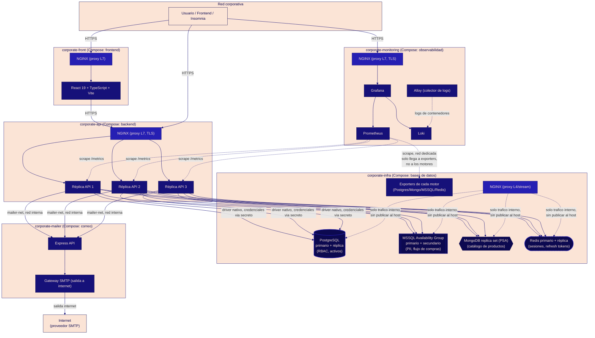

# corporate-app

ERP corporativo en desarrollo: gestión de personas/usuarios/roles (RBAC granular), terceros
(clientes y proveedores), flujo completo de compras (solicitud → cotización → autorización →
orden de compra → recepción) y control de activos. Arquitectura de microservicios con Docker
Compose, motor de base de datos elegido según la sensibilidad del dato (no por conveniencia), y
observabilidad (métricas + logs) desde el día uno.

> El motor elegido por dominio no es antojadizo: PII y flujo de compras van en MSSQL con
> Availability Group (consistencia fuerte), RBAC y activos en PostgreSQL (relacional, con
> replicación por streaming), catálogo de productos en MongoDB (esquema flexible, replica set) y
> sesiones/tokens en Redis (volátil, replicado).

## Estado actual

| Módulo | Estado |
|---|---|
| `corporate-infra` (bases de datos) | ✅ Construido, hardenizado y validado con instalación limpia real |
| `corporate-api` (backend) | ✅ Construido: auth, RBAC, ERP core, flujo de compras, activos (Kardex, ZPL, handover), tiempo real |
| `corporate-mailer` (servicio de correo) | ✅ Construido: adjuntos de OC, notificaciones, SMTP |
| `corporate-monitoring` (observabilidad) | ✅ Construido: métricas, logs, dashboards, todo detrás de TLS |
| `corporate-front` (frontend) | ✅ Construido: React 19/TypeScript/Tailwind v4, menú dinámico desde BD, activos, adquisiciones, solicitudes, personas, permissions |
| Ambientes `prod`/`test` | ✅ Compose/Dockerfiles existen; `dev` es el único validado en clean-install real |

## Arquitectura general

Cinco proyectos Docker Compose independientes, cada uno con su propia red interna, orquestados
desde la raíz del repo. Solo `corporate-api`, `corporate-front` y `corporate-monitoring` (los tres
vía su propio NGINX) exponen puertos hacia la red corporativa; `corporate-mailer` solo tiene egreso
saliente hacia el proveedor SMTP; ningún motor de base de datos publica puertos directamente al host.



**Cómo se levanta** (orquestador `run.ps1` en la raíz, dispatch a `corporate-scripts/*.ps1`):

```
run.ps1 bdd dev          # 1. corporate-infra: bases de datos + replicación
run.ps1 backend dev      # 2. corporate-api: migra, siembra datos base y levanta las 3 réplicas
run.ps1 mailer dev       # 3. corporate-mailer: servicio de envío de correo
run.ps1 frontend dev     # 4. corporate-front: React, sidebar dinámico desde /auth/menu
run.ps1 monitoring dev   # 5. corporate-monitoring: métricas/logs/dashboards
```

`monitoring` depende de una red externa que crea `backend` (para que Prometheus alcance a las 3
réplicas de la API por nombre) — por eso `backend` va antes. Los 3 ambientes (`dev`, `prod`, `test`)
usan el mismo comando con el sufijo ambiente: `run.ps1 backend prod`, `run.ps1 backend test`, etc.
También está `run.ps1 mongokey <ambiente>` para generar el keyfile de MongoDB, y `run.ps1 fixendline`
(sin ambiente) para corregir terminaciones de línea en Windows.

Cada script de `corporate-scripts/` genera certificados TLS autofirmados y resuelve credenciales
desde `corporate-secrets/` (carpeta **excluida de git**, un archivo por credencial, montados como
Docker secrets) antes de levantar su stack — ningún valor sensible vive en el código ni en este
README, solo se referencia el mecanismo.

## Estructura del repositorio

```
corporate-app/
├── corporate-infra/       # Compose: PostgreSQL, MSSQL (AG), MongoDB (replica set), Redis, NGINX
├── corporate-api/         # Backend Express/TypeScript (DDD, tiempo real, adjuntos) — ver detalle abajo
├── corporate-mailer/      # Microservicio de correo: adjuntos OC, notificaciones, SMTP
├── corporate-monitoring/  # Compose: Prometheus, Loki, Alloy, Grafana, NGINX (TLS)
├── corporate-front/       # Frontend React 19/TypeScript/Tailwind v4 (Vite) — menú dinámico desde BD
├── corporate-scripts/     # Scripts PowerShell de orquestación (certs, secretos, arranque)
├── corporate-secrets/     # Credenciales/certificados por ambiente — excluido de git
└── run.ps1                # Punto de entrada único: run.ps1 <bdd|backend|mailer|monitoring|frontend> <dev|prod|test>
```

> Este árbol muestra lo que trae el repositorio (`git clone`). Además, quien trabaje con Claude Code
> en este proyecto tiene localmente una carpeta `.claude/` (contexto, specs, roles, agentes) que
> **no se versiona** (`.gitignore`) — es configuración de esa herramienta, no parte del repo en sí.

### `corporate-api/src/` (DDD por capas)

```
src/
├── routes/         # Un router por recurso, monta permisos con authorize(resource, action)
├── controllers/     # Validación de entrada (Zod) + orquestación de la respuesta
├── services/         # Reglas de negocio, separadas por motor: mssql/ postgres/ mongo/ redis/
├── models/           # Definiciones Sequelize (mssql/, postgres/) y Mongoose (mongo/)
├── middlewares/       # authenticate, authorize, rateLimit, validate, errorHandler
├── library/           # jwt, password, pagination, búsqueda genérica, numeración de documentos, etc.
└── databases/         # Conexión + migración idempotente por motor, catálogo de permisos, seed
```

## Tecnologías

**Backend (`corporate-api`)**
- Node.js + TypeScript, Express 5
- Sequelize (PostgreSQL vía `pg`, MSSQL vía `tedious`) + Mongoose (MongoDB)
- Redis (cliente oficial `redis`) para sesiones (`express-session` + `connect-redis`) y refresh tokens
- `jsonwebtoken` (access/refresh JWT), `bcryptjs` (hash de contraseñas), `zod` (validación de esquemas)
- `helmet`, `cors`, `express-rate-limit` (seguridad HTTP)
- `pino`/`pino-http` (logging estructurado), `prom-client` (métricas Prometheus)
- `socket.io` + `@socket.io/redis-adapter` (notificaciones en tiempo real, escalado entre 3 réplicas)
- `multer` (gestión de adjuntos: órdenes de compra, recibos), `pdfkit` (generación de PDF: handover de activos)

**Frontend (`corporate-front`)**
- React 19 + TypeScript, Vite, Tailwind CSS v4
- `react-router-dom` (enrutamiento), `react-toastify` (notificaciones), `socket.io-client` (tiempo real)
- `react-icons/io5` (iconografía), `@fdograph/rut-utilities` (validación de RUT chileno)
- Menú y rutas dinámicas desde BD (`GET /auth/menu` — el menú es la autoridad de ruteo)

**Servicio de Correo (`corporate-mailer`)**
- Node.js + TypeScript, Express 5
- `nodemailer` (envío SMTP); recibe los adjuntos ya codificados (PDF en base64, dentro del body JSON)
  desde `corporate-api` — no maneja `multipart/form-data` ni tiene `multer` propio
- Red interna dedicada (`mailer-net`) con corporate-api; único contenedor del proyecto con egreso a
  internet, en una red aislada
- Redacción de credenciales en logs (`pino-http`, header `x-mailer-token` censurado — hallazgo de la
  auditoría de seguridad del 2026-08-17, mismo fix aplicado antes en `corporate-api`)

**Infraestructura (`corporate-infra`)**
- PostgreSQL (streaming replication primario/réplica)
- Microsoft SQL Server (Availability Group, read-scale, sin WSFC)
- MongoDB (replica set, topología PSA: primary-secondary-arbiter)
- Redis (replicación primario/réplica)
- NGINX como único proxy hacia las bases de datos (sin publicar puertos de los motores)

**Observabilidad (`corporate-monitoring`)**
- Prometheus (scraping de exporters de cada motor + `/metrics` de cada réplica API)
- Grafana (dashboards, servido por TLS)
- Loki + Alloy (agregación de logs de contenedores)
- NGINX como proxy TLS hacia Grafana

**Orquestación**
- Docker Compose (un stack por servicio: infra, api, mailer, monitoring, front)
- PowerShell (`corporate-scripts/`) para generación de certificados, resolución de secretos y arranque
- Redes Docker por ambiente: dev (`172.16.x.0/24`), test (`10.10.x.0/24`), prod (`10.200.x.0/24`)

## Funcionalidades implementadas

- **Autenticación híbrida**: sesión (cookie, Redis store) para clientes web y JWT access/refresh
  para clientes stateless (mobile/integraciones), aceptados indistintamente por el mismo guard.
  Rotación de refresh tokens, revocación en logout, rate limiting en login.
- **Cambio de contraseña**: auto-servicio (`/auth/change-password`, valida contraseña actual) y
  administrativo (`/users/:id/password`, requiere permiso). Historial de contraseñas (no se puede
  reutilizar ninguna de las últimas N) y política de complejidad mínima.
- **Invalidación de sesión por "watermark"**: cambiar de rol, cambiar contraseña o desactivar un
  usuario invalida de inmediato cualquier sesión/token ya emitido, sin esperar a que expire.
- **RBAC granular**: catálogo de permisos (`resource` + `action`) versionado en código, asignable
  por rol vía API; cada endpoint declara explícitamente qué permiso requiere. Menú de navegación
  dinámico (`GET /auth/menu`) que el frontend consulta para determinar rutas/sidebar en función del usuario.
- **Personas, usuarios y roles**: alta/baja/modificación con separación persona ↔ cuenta de acceso.
- **Terceros (Business Partners)**: entidad base compartida entre clientes y proveedores (sin
  duplicar razón social/RUT), con extensiones `Supplier` y `Customer` 1:1.
- **Geografía y catálogos**: países, ciudades, estados/regiones, centros de costo — datos de
  referencia sembrados automáticamente al arrancar.
- **Catálogo de productos**: en MongoDB, pensado para esquema flexible (variantes, atributos).
- **Flujo de compras end-to-end**: `PurchaseRequest → Quote → Authorization → PurchaseOrder → GoodsReceipt`,
  con máquina de estados, pasos de cotización, autorización restringida al aprobador asignado,
  numeración de documentos secuencial (folios que nunca se reutilizan), adjuntos de orden de compra,
  envío automático a proveedor vía `corporate-mailer` y tracking por orden.
- **Gestión de activos completa**: alta de activos vinculados a compra, **Kardex de valorización**
  (entrada/salida, costo promedio móvil), **impresión de etiquetas ZPL**, asignación a colaboradores,
  **flujo de entrega (handover) con PDF** generado dinámicamente, trazabilidad de movimientos
  incluyendo responsables.
- **Notificaciones en tiempo real**: eventos de cambio de estado (`socket.io` + `@socket.io/redis-adapter`,
  escalado entre 3 réplicas) sin polling.
- **Envío de correos**: `corporate-mailer` gestiona adjuntos (PDF, facturas), notificaciones
  a proveedores y usuarios, salida SMTP aislada en su propia red Docker.
- **Multi-réplica real**: 3 instancias de la API detrás de NGINX, migraciones y seeds escritos para
  ser idempotentes y seguros frente a arranque concurrente de las 3 réplicas contra una base recién creada.

## Seguridad

- Ningún motor de base de datos publica puertos directamente; todo el tráfico externo pasa por
  NGINX (backend y monitoreo), con TLS.
- Credenciales gestionadas como Docker secrets (un archivo por credencial, fuera de git) — nunca
  hardcodeadas ni versionadas.
- Puertos publicados bindeados a la interfaz de red corporativa, no a todas las interfaces del host.
- Prometheus solo alcanza a los *exporters* de cada motor por una red dedicada, sin ruta de red
  hacia los motores de base de datos en sí.
- Auditoría de seguridad aplicada (hallazgos corregidos): exposición de puertos, cookies de sesión
  sin TLS, y una condición de carrera real en la migración de MSSQL al arrancar 3 réplicas contra
  una base vacía por primera vez.

## Cómo levantar el proyecto

Requiere Docker Desktop y PowerShell 7+. Los 5 stacks se levantan en orden desde la raíz del repo.
Ejemplo para ambiente `dev`:

```powershell
# 1. Bases de datos (PostgreSQL, MSSQL, MongoDB, Redis)
.\run.ps1 bdd dev

# 2. Backend (3 réplicas de API + NGINX)
.\run.ps1 backend dev

# 3. Servicio de correo (SMTP, notificaciones, adjuntos)
.\run.ps1 mailer dev

# 4. Frontend (React, menú dinámico desde /auth/menu)
.\run.ps1 frontend dev

# 5. Monitoreo (Prometheus, Grafana, Loki)
.\run.ps1 monitoring dev
```

El mismo flujo funciona para `prod` y `test`:
```powershell
.\run.ps1 bdd prod
.\run.ps1 backend prod
.\run.ps1 mailer prod
.\run.ps1 frontend prod
.\run.ps1 monitoring prod
```

Comandos adicionales:
```powershell
.\run.ps1 mongokey <ambiente>   # Generar keyfile de MongoDB para el ambiente
.\run.ps1 fixendline            # Corregir terminaciones de línea (Windows)
```

Cada script resuelve por su cuenta las credenciales/certificados que necesita (ver
`corporate-scripts/`); no requieren configuración manual adicional más allá de tener
`corporate-secrets/` poblado para el ambiente elegido.

## Limitaciones conocidas y notas de desarrollo

- **Ambientes `prod`/`test`**: existen archivos `compose.prod.yml` y `compose.test.yml` en todos los
  stacks, pero **solo `dev` ha sido validado en una instalación limpia real**. Verificar el estado
  de `prod`/`test` en cada stack antes de usar en producción; pueden requerir ajustes de configuración
  específicos del ambiente (redes, credenciales, volúmenes).
- **Frontend**: `corporate-front` está en desarrollo activo; el layout y páginas cubren activos,
  adquisiciones, solicitudes, personas y permissions. Pueden existir placeholders o páginas no
  totalmente implementadas en módulos específicos.
- **Scripts de arranque y `--build`**: algunos scripts de `corporate-scripts/` no pasan `--build` al
  levantar un Compose, lo que significa que cambios en Dockerfiles/templating no se reconstruyen
  automáticamente. Ejecutar `docker compose down -v` y relanzar si hay cambios de imagen no detectados.
- **pnpm en Docker Windows**: pnpm dentro de Dockerfiles en este host (Windows + WSL2) genera symlinks
  rotos. Los Dockerfiles usan `npm` en lugar de `pnpm` para evitarlo — `pnpm` sigue siendo el gestor
  del lado del host (`pnpm-lock.yaml`).
