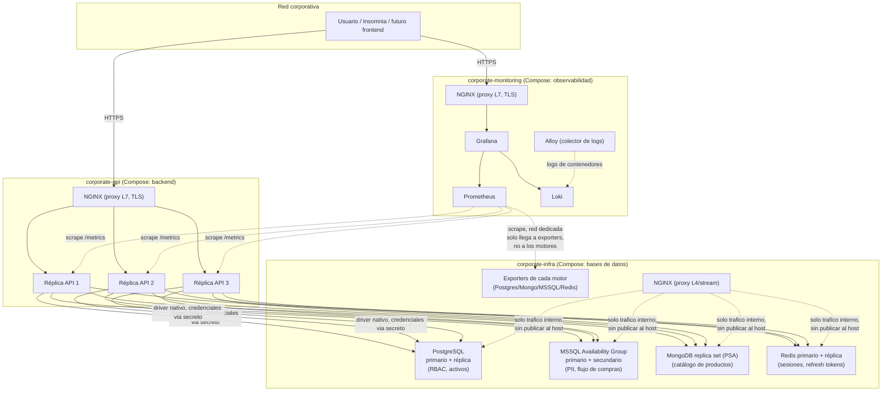

# corporate-app

ERP corporativo en desarrollo: gestión de personas/usuarios/roles (RBAC granular), terceros
(clientes y proveedores), flujo completo de compras (solicitud → cotización → autorización →
orden de compra → recepción) y control de activos. Arquitectura de microservicios con Docker
Compose, motor de base de datos elegido según la sensibilidad del dato (no por conveniencia), y
observabilidad (métricas + logs) desde el día uno.

> El motor elegido por dominio no es antojadizo: PII y flujo de compras van en MSSQL con
> Availability Group (consistencia fuerte), RBAC y activos en PostgreSQL (relacional, con
> replicación por streaming), catálogo de productos en MongoDB (esquema flexible, replica set) y
> sesiones/tokens en Redis (volátil, replicado).

## Estado actual

| Módulo | Estado |
|---|---|
| `corporate-infra` (bases de datos) | ✅ Construido, hardenizado y validado con instalación limpia real |
| `corporate-api` (backend) | ✅ Construido: auth, RBAC, ERP core, flujo de compras, activos |
| `corporate-monitoring` (observabilidad) | ✅ Construido: métricas, logs, dashboards, todo detrás de TLS |
| `corporate-front` (frontend) | ⏳ Pendiente — carpeta existe, sin implementación aún |
| Ambientes `prod`/`test` | ⏳ Pendiente — solo `dev` está validado hoy (`compose.prod.yml`/`compose.test.yml` no existen) |

## Arquitectura general

Tres proyectos Docker Compose independientes, cada uno con su propia red interna, orquestados
desde la raíz del repo. Solo `corporate-api` (vía NGINX) y `corporate-monitoring` (Grafana, vía
NGINX) exponen puertos hacia la red corporativa; ningún motor de base de datos publica puertos
directamente al host.



**Cómo se levanta** (orquestador `run.ps1` en la raíz, dispatch a `corporate-scripts/*.ps1`):

```
run.ps1 bdd dev          # 1. corporate-infra: bases de datos + replicación
run.ps1 backend dev      # 2. corporate-api: migra, siembra datos base y levanta las 3 réplicas
run.ps1 monitoring dev   # 3. corporate-monitoring: métricas/logs/dashboards
run.ps1 frontend dev     # 4. corporate-front: pendiente de implementación
```

`monitoring` depende de una red externa que crea `backend` (para que Prometheus alcance a las 3
réplicas de la API por nombre) — por eso `backend` va antes que `monitoring`, aunque monitoreo no
dependa de la API para nada más.

Cada script de `corporate-scripts/` genera certificados TLS autofirmados y resuelve credenciales
desde `corporate-secrets/` (carpeta **excluida de git**, un archivo por credencial, montados como
Docker secrets) antes de levantar su stack — ningún valor sensible vive en el código ni en este
README, solo se referencia el mecanismo.

## Estructura del repositorio

```
corporate-app/
├── corporate-infra/       # Compose: PostgreSQL, MSSQL (AG), MongoDB (replica set), Redis, NGINX
├── corporate-api/         # Backend Express/TypeScript (DDD) — ver detalle abajo
├── corporate-monitoring/  # Compose: Prometheus, Loki, Alloy, Grafana, NGINX
├── corporate-front/       # Frontend — pendiente
├── corporate-scripts/     # Scripts PowerShell de orquestación (certs, secretos, arranque)
├── corporate-secrets/     # Credenciales/certificados por ambiente — excluido de git
├── .claude/agents/        # 21 subagentes de proyecto (orquestadores, QA, seguridad, infra, etc.)
└── run.ps1                # Punto de entrada único: run.ps1 <bdd|monitoring|backend|frontend> <dev|prod|test>
```

### `corporate-api/src/` (DDD por capas)

```
src/
├── routes/         # Un router por recurso, monta permisos con authorize(resource, action)
├── controllers/     # Validación de entrada (Zod) + orquestación de la respuesta
├── services/         # Reglas de negocio, separadas por motor: mssql/ postgres/ mongo/ redis/
├── models/           # Definiciones Sequelize (mssql/, postgres/) y Mongoose (mongo/)
├── middlewares/       # authenticate, authorize, rateLimit, validate, errorHandler
├── library/           # jwt, password, pagination, búsqueda genérica, numeración de documentos, etc.
└── databases/         # Conexión + migración idempotente por motor, catálogo de permisos, seed
```

## Tecnologías

**Backend (`corporate-api`)**
- Node.js + TypeScript, Express 5
- Sequelize (PostgreSQL vía `pg`, MSSQL vía `tedious`) + Mongoose (MongoDB)
- Redis (cliente oficial `redis`) para sesiones (`express-session` + `connect-redis`) y refresh tokens
- `jsonwebtoken` (access/refresh JWT), `bcryptjs` (hash de contraseñas), `zod` (validación de esquemas)
- `helmet`, `cors`, `express-rate-limit` (seguridad HTTP)
- `pino`/`pino-http` (logging estructurado), `prom-client` (métricas Prometheus)

**Infraestructura (`corporate-infra`)**
- PostgreSQL (streaming replication primario/réplica)
- Microsoft SQL Server (Availability Group, read-scale, sin WSFC)
- MongoDB (replica set, topología PSA: primary-secondary-arbiter)
- Redis (replicación primario/réplica)
- NGINX como único proxy hacia las bases de datos (sin publicar puertos de los motores)

**Observabilidad (`corporate-monitoring`)**
- Prometheus (scraping de exporters de cada motor + `/metrics` de cada réplica API)
- Grafana (dashboards, servido por TLS)
- Loki + Alloy (agregación de logs de contenedores)
- NGINX como proxy TLS hacia Grafana

**Orquestación**
- Docker Compose (un proyecto por stack: infra, api, monitoring)
- PowerShell (`corporate-scripts/`) para generación de certificados, resolución de secretos y arranque

## Funcionalidades implementadas

- **Autenticación híbrida**: sesión (cookie, Redis store) para clientes web y JWT access/refresh
  para clientes stateless (mobile/integraciones), aceptados indistintamente por el mismo guard.
  Rotación de refresh tokens, revocación en logout, rate limiting en login.
- **Cambio de contraseña**: auto-servicio (`/auth/change-password`, valida contraseña actual) y
  administrativo (`/users/:id/password`, requiere permiso). Historial de contraseñas (no se puede
  reutilizar ninguna de las últimas N) y política de complejidad mínima.
- **Invalidación de sesión por "watermark"**: cambiar de rol, cambiar contraseña o desactivar un
  usuario invalida de inmediato cualquier sesión/token ya emitido, sin esperar a que expire.
- **RBAC granular**: catálogo de permisos (`resource` + `action`) versionado en código, asignable
  por rol vía API; cada endpoint declara explícitamente qué permiso requiere.
- **Personas, usuarios y roles**: alta/baja/modificación con separación persona ↔ cuenta de acceso.
- **Terceros (Business Partners)**: entidad base compartida entre clientes y proveedores (sin
  duplicar razón social/RUT), con extensiones `Supplier` y `Customer` 1:1.
- **Geografía y catálogos**: países, ciudades, estados/regiones, centros de costo — datos de
  referencia sembrados automáticamente al arrancar.
- **Catálogo de productos**: en MongoDB, pensado para esquema flexible (variantes, atributos).
- **Flujo de compras end-to-end**: `PurchaseRequest → Quote → Authorization → PurchaseOrder → GoodsReceipt`,
  con numeración de documentos secuencial (folios que nunca se reutilizan, aunque se borre el registro).
- **Gestión de activos**: alta, estados y trazabilidad de movimientos (incluye responsables del movimiento).
- **Multi-réplica real**: 3 instancias de la API detrás de NGINX, migraciones y seeds escritos para
  ser idempotentes y seguros frente a arranque concurrente de las 3 réplicas contra una base recién creada.

## Seguridad

- Ningún motor de base de datos publica puertos directamente; todo el tráfico externo pasa por
  NGINX (backend y monitoreo), con TLS.
- Credenciales gestionadas como Docker secrets (un archivo por credencial, fuera de git) — nunca
  hardcodeadas ni versionadas.
- Puertos publicados bindeados a la interfaz de red corporativa, no a todas las interfaces del host.
- Prometheus solo alcanza a los *exporters* de cada motor por una red dedicada, sin ruta de red
  hacia los motores de base de datos en sí.
- Auditoría de seguridad aplicada (hallazgos corregidos): exposición de puertos, cookies de sesión
  sin TLS, y una condición de carrera real en la migración de MSSQL al arrancar 3 réplicas contra
  una base vacía por primera vez.

## Cómo levantar el proyecto

Requiere Docker Desktop y PowerShell. Los 3 stacks se levantan en orden desde la raíz del repo:

```powershell
.\run.ps1 bdd dev
.\run.ps1 monitoring dev
.\run.ps1 backend dev
```

Cada script resuelve por su cuenta las credenciales/certificados que necesita (ver
`corporate-scripts/`); no requieren configuración manual adicional más allá de tener
`corporate-secrets/` poblado para el ambiente elegido.

## Limitaciones conocidas

- Solo el ambiente `dev` está implementado y validado hoy; `prod`/`test` son placeholders en
  `run.ps1` sin archivos Compose propios todavía.
- No existe frontend todavía (`corporate-front/` está vacío) — el consumo actual de la API es vía
  clientes REST (Insomnia/Postman) o integraciones directas.
- El script de arranque de `corporate-monitoring` no reconstruye imágenes automáticamente
  (falta `--build`); un cambio en su Dockerfile/config requiere reconstruir manualmente.
