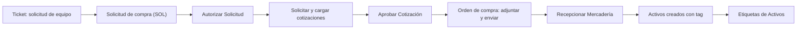
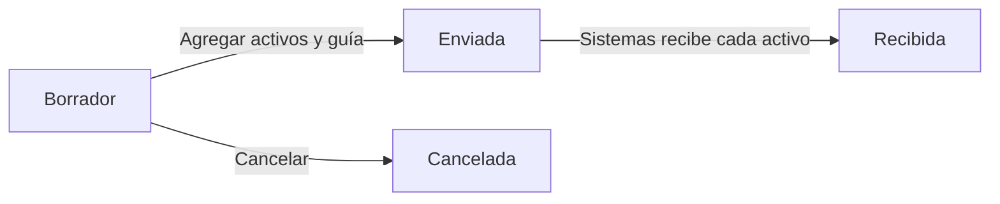
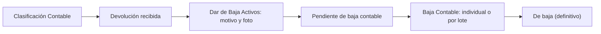
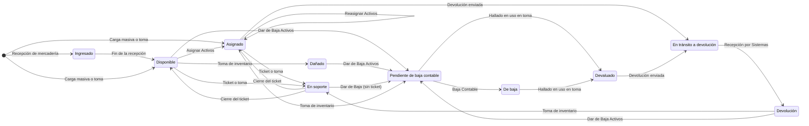

# Manual de Operación — corporate-app

Quién hace qué, en qué pantalla y con qué permiso: acceso y roles, alta de colaboradores, compras,
movimiento de activos, devoluciones, bajas, inventario, contabilidad de activos y Service Desk.

Actualizado al 28 de septiembre de 2026 (planes 000 a 014).

## Contenido

1. [Acceso y permisos](#1-acceso-y-permisos)
2. [Roles](#2-roles)
3. [Alta de colaboradores](#3-alta-de-colaboradores)
4. [Compras y recepción](#4-compras-y-recepción)
5. [Asignar y reasignar](#5-asignar-y-reasignar)
6. [Devoluciones](#6-devoluciones)
7. [Dar de baja y baja contable](#7-dar-de-baja-y-baja-contable)
8. [Toma de inventario](#8-toma-de-inventario)
9. [Contabilidad de activos](#9-contabilidad-de-activos)
10. [Service Desk](#10-service-desk)
11. [Ciclo de vida del activo](#11-ciclo-de-vida-del-activo)
12. [Glosario y folios](#12-glosario-y-folios)

---

## 1. Acceso y permisos

El acceso sigue una cadena: el **colaborador** ocupa un **cargo**, el cargo tiene un **rol** y el rol
reúne los permisos de las **pantallas** que puede usar. El menú de cada persona muestra solo las
pantallas que su rol permite.

- **El nombre del rol lleva el centro de costo** como prefijo: `1110-analista-adquisiciones`,
  `5802-gerente-tienda`, `1072-analista-contable`. Nuevo Rol lo arma así.
- **Pantalla de lectura y pantalla de edición.** «Pantalla: X» abre la pantalla en el menú y deja ver
  los datos. «Pantalla: X (edición)» habilita las acciones (crear, enviar, recibir). Para operar hacen
  falta las dos. Excepción: «Valorización de Activos» ya incluye ingresar el valor.
- **El administrador prepara el acceso antes del ingreso:** crea el rol, le asigna las pantallas, crea
  el cargo vinculado a ese rol y recién entonces da de alta al colaborador.
- **Primer ingreso:** el usuario nuevo entra con la contraseña por defecto del ambiente y el sistema le
  exige cambiarla.

## 2. Roles

Estos son los 9 roles de trabajo y lo que cada uno hace en el sistema. Son los mismos que se cargan
como datos de prueba en Development y Testing.

### 5802 · Tienda Sta Rosa Maderas

| Rol | Qué hace |
|-----|----------|
| `5802-gerente-tienda` | Aprueba solicitudes y cotizaciones, arma y envía devoluciones de su tienda, sigue el estado de los activos solicitados y abre tickets. |
| `5802-jefe-ventas` | Aprueba solicitudes y cotizaciones, ve las devoluciones, adjunta órdenes de compra y abre tickets. |
| `5802-vendedor-tienda` | Ve las devoluciones, adjunta órdenes de compra y abre tickets. |

### 1110 · Sistemas

| Rol | Qué hace |
|-----|----------|
| `1110-analista-adquisiciones` | Proveedores, cotizaciones, órdenes de compra, recepción, productos y categorías. Asigna, da de baja y etiqueta activos, reimprime actas, hace tomas de inventario, cargas masivas y valorizaciones, y recibe devoluciones. |
| `1110-jefe-soporte` | Supervisa el Service Desk (ve todos los tickets y lo configura), aprueba solicitudes y cotizaciones, y apoya en asignación, recepción, inventario, productos y proveedores. |
| `1110-tecnico-soporte` · `1110-soporte-redes` | Atienden tickets de soporte, asignan y etiquetan activos, recepcionan mercadería, participan en la toma de inventario y ven las devoluciones. |
| `1110-analista-funcional` | Administra permisos, roles y pantallas, y abre tickets. |

### 1072 · Contabilidad

| Rol | Qué hace |
|-----|----------|
| `1072-analista-contable` | Clasificación contable, costo, capitalización, depreciación, política contable y baja contable. También ve el Kardex, valoriza, adjunta y envía órdenes de compra y abre tickets. |

> **Recibir devoluciones es solo de Sistemas.** Aunque otro rol tenga la pantalla de edición de
> Devoluciones, solo un rol `1110-…` (o el administrador) puede recibirlas. Los demás centros de costo
> solo las solicitan.

## 3. Alta de colaboradores

La configuración inicial se hace una sola vez; después, cada persona nueva entra por Nuevo Ingreso.

1. **Crear el rol** con el prefijo de su centro de costo.
   *Gerencia de Personas › Roles › Nuevo Rol*
2. **Asignar las pantallas al rol**, de lectura y de edición según corresponda.
   *Gerencia de TI › Serv. Productivos › Permisos › Permisos de Pantalla*
3. **Crear el cargo** con sus funciones y habilidades, y vincularlo al rol.
   *Gerencia de Personas › Colaboradores › Cargos › Nuevo Cargo*
4. **Configurar la empresa** (una vez): CCAF y mutualidad, y el sistema de gratificación.
   *Gerencia de Personas › Previsión › CCAF y Mutualidad* · *Gerencia de Personas › Remuneraciones › Configuración de Remuneraciones*
5. **Nuevo Ingreso:** datos personales y dirección, centro de costo y cargo, contrato (sueldo base y
   gratificación), AFP y salud, y nombre de usuario. El rol del usuario sale del cargo, no se elige aparte.
   *Gerencia de Personas › Colaboradores › Nuevo Ingreso*

En Development y Testing todo esto ya viene cargado al levantar el ambiente desde cero: 9 roles con sus
permisos, 9 cargos, la configuración de la empresa y 9 colaboradores.

## 4. Compras y recepción

| Paso | Quién · Pantalla | Qué se hace |
|------|------------------|-------------|
| 1. Pedir el equipo | Cualquier colaborador · *Solicitudes › Generar Ticket* | Se elige la solicitud de equipo: se crea el ticket (folio REQ) y, vinculada, la solicitud de compra (folio SOL). La compra va moviendo el ticket. |
| 2. Autorizar la solicitud | Gerente o jefe con «Autorizar Solicitud» | Quien solicita no puede autorizar su propia compra. |
| 3. Cotizar | Adquisiciones TI · *Adquisiciones › Compras* | Pedir cotizaciones a los proveedores y cargarlas. |
| 4. Aprobar la cotización | Gerente o jefe con «Aprobar Cotización» | Se aprueba la cotización elegida. |
| 5. Orden de compra | Adquisiciones TI y Contabilidad | Adjuntarla y enviarla al proveedor. |
| 6. Recepcionar | Sistemas · *Adquisiciones › Productos › Recepcionar Mercadería* | Cantidades y números de serie. Cada unidad nace como activo y queda **Disponible**, con un tag cuyo prefijo depende del tipo de producto (ARR arriendo, SRV servicio, ACT compra). |
| 7. Etiquetar | Sistemas · *Adquisiciones › Productos › Etiquetas de Activos* | Imprimir las etiquetas de los activos. |

Los activos que entran sin valor (por una toma de inventario o una carga masiva) se valorizan en
*Adquisiciones › Productos › Valorización de Activos*, que deja el valor en el Kardex.

## 5. Asignar y reasignar

*Gerencia de TI › Serv. Productivos › Adquisiciones › Movimiento Activos*

| Pantalla | Qué se hace |
|----------|-------------|
| Asignar Activos | Se busca un activo **Disponible** por tag o serie, se elige al colaborador y se completan los datos del acta (jefe directo, almacenamiento, RAM, MAC y accesorios). Queda **Asignado** y se descarga el **acta de entrega** en PDF. Si el activo no está disponible, la pantalla avisa en qué estado está. |
| Reasignar Activos | Cambia un activo asignado a otro colaborador o a otro centro de costo, con un acta nueva. Los datos del acta vienen precargados. |
| Visualizar Asignaciones | Listado de lo asignado, con filtros por centro de costo, usuario (nombre o RUT completo), serie y categoría. |
| Formulario Asignación | Reimprime el acta vigente de un activo. |

El acta muestra marca, modelo, serie, tag, proveedor, almacenamiento, RAM, accesorios, MAC y valor.
Bolso y candado aplican solo a notebooks, el cargador a notebooks y monitores, y la MAC a notebooks y
equipos de escritorio; en el resto figuran como «No Aplica».

## 6. Devoluciones

*Adquisiciones › Productos › Devoluciones de Activos*

1. **Armar la devolución** (borrador) con los activos asignados del centro de costo: los propios o los
   de otro usuario. Lo hace un rol con «Devoluciones de Activos (edición)», por ejemplo el gerente de tienda.
2. **Adjuntar la guía de despacho** y **enviar**. Al enviar se genera el código DEV y cada activo pasa a
   **En tránsito a devolución**. Mientras está en tránsito no admite ningún otro movimiento.
3. **Recibir** los activos, uno a uno o todos juntos. Cada activo recibido queda en **Devolución**.
   Recibe solo Sistemas (rol 1110) o el administrador, aunque haya sido quien la envió.

## 7. Dar de baja y baja contable

La baja tiene dos momentos: la **baja operativa**, que hace Sistemas con la foto del equipo, y la
**baja contable**, que confirma Contabilidad con el certificado notarial.

### Dar de Baja Activos

*Adquisiciones › Movimiento Activos › Dar de Baja Activos* · rol 1110 con «Pantalla: Dar de Baja Activos»

- **Solo activos que están en Sistemas:** Devolución, En soporte sin ticket abierto, Dañado, Disponible
  o Ingresado. Un activo asignado primero se devuelve con su guía.
- **Tiene que estar clasificado** en *Contabilidad › Clasificación Contable*; si no, la pantalla lo avisa
  y no deja continuar.
- **Motivo obligatorio:** Obsolescencia, Daño irreparable, Robo / Pérdida u Otro (con detalle obligatorio).
- **Foto obligatoria** del equipo, JPEG o PNG. En el celular se toma con la cámara.
- **Al confirmar,** el Kardex queda en cero y el activo pasa a **Pendiente de baja contable**.

### Baja Contable

*Contabilidad › Gestión de Activos › Baja Contable* · `1072-analista-contable`

- **Baja individual** (un activo) o **baja por lote** (todos los pendientes que no estén en otro
  borrador, hasta 200). También se pueden elegir varios a mano.
- Cada baja lleva fecha, motivo, notaría, número de certificado y **un certificado notarial en PDF**
  para todos sus activos.
- La foto de cada activo es la que se tomó al darlo de baja. Solo los que dio de baja una toma de
  inventario (sin foto) piden subirla aquí.
- Al confirmar, la baja es **definitiva**: cada activo queda **De baja** y se guarda su valor libro de
  ese momento.

## 8. Toma de inventario

*Adquisiciones › Productos › Toma de Inventario* · ver con «Toma de Inventario», registrar con
«Toma de Inventario (edición)»

1. **Iniciar** la toma de un centro de costo. Recibe un folio `IT2026000001`.
2. **Registrar lo encontrado** por tag o serie, con el estado en que se halla (asignado, en soporte,
   disponible, dañado o de baja) y su usuario. La pantalla indica qué cambios acepta cada activo.
3. **Lo que no existe en el sistema** se crea como activo nuevo, sin valor, y se imprime su etiqueta.
   Después se valoriza.
4. **Finalizar** la toma. El informe lista encontrados, nuevos, cambios y faltantes.

- **Un activo en Devolución** que aparece en la toma queda **En soporte**, para que Sistemas lo revise.
- **Un activo dado de baja que aparece en uso** queda **Devaluado**: asignado, con valor 0 y sin tocar
  el Kardex.
- **Un activo en tránsito de devolución** no se puede inventariar hasta que se reciba.

## 9. Contabilidad de activos

*Contabilidad › Gestión de Activos* · `1072-analista-contable`

| Pantalla | Qué se hace |
|----------|-------------|
| Política Contable | Umbral de capitalización y clases de activo con su vida útil. |
| Clasificación Contable | Cada activo se clasifica como activo fijo o gasto. Es requisito para darlo de baja. |
| Determinar Costo | Costo del activo más los costos atribuibles (flete, instalación). |
| Capitalización | El activo fijo costeado se capitaliza y define desde qué mes se deprecia. |
| Depreciación | Cierre mensual de la depreciación. Se puede anular el último cierre. |
| Baja Contable | Ver [Dar de baja y baja contable](#7-dar-de-baja-y-baja-contable). |

## 10. Service Desk

- **Abrir un ticket:** cualquier colaborador lo hace desde *Solicitudes › Generar Ticket*, sea un
  incidente (INC) o una solicitud (REQ). La solicitud de equipo crea además la solicitud de compra.
- **Atender:** Soporte trabaja los tickets de su grupo en *Gerencia de TI › Soporte*. Estados: Nuevo,
  Asignado, En curso, En espera (con motivo), Resuelto y Cerrado. El SLA se mide en horario hábil.
- **Activos en soporte:** un activo en soporte por un ticket solo vuelve desde ese ticket, a su usuario
  o a bodega.
- **Problemas, cambios y base de conocimiento:** problemas (PRB), cambios con aprobación del CAB (CHG) y
  artículos de la base de conocimiento (KB).
- **Configuración** (jefe de soporte): grupos, categorías, catálogo de servicios, calendario hábil,
  matriz de prioridad y SLA.

## 11. Ciclo de vida del activo

Estados reales del sistema y la pantalla que provoca cada cambio.

| Estado | Qué significa | Qué se puede hacer |
|--------|---------------|--------------------|
| Ingresado | Recién creado al recepcionar la mercadería. | Pasa a Disponible al terminar la recepción; también se puede dar de baja. |
| Disponible | En bodega, listo para entregar. | Asignar, enviar a soporte, dar de baja. |
| Asignado | En manos de un colaborador, con acta. | Reasignar, reimprimir acta, devolver, enviar a soporte. |
| En soporte | En reparación o revisión. | Con ticket: vuelve solo desde el ticket. Sin ticket: dar de baja. |
| Dañado | Registrado dañado en una toma. | Dar de baja. |
| En tránsito a devolución | Despachado con guía hacia Sistemas. | Solo recibirlo en Devoluciones. |
| Devolución | Recibido por Sistemas, pendiente de revisión. | Dar de baja; en una toma pasa a soporte. |
| Pendiente de baja contable | Baja operativa hecha: Kardex en cero y foto guardada. | Baja Contable. Si una toma lo encuentra en uso, queda devaluado. |
| De baja | Baja contable confirmada. Es definitiva. | Nada, salvo que una toma lo encuentre en uso (queda devaluado). |
| Devaluado | Estaba de baja y se encontró en uso: asignado con valor 0. | Devolverlo; en una toma, cambiar de usuario o volver a darlo de baja. |

## 12. Glosario y folios

| Término | Significado |
|---------|-------------|
| Kardex | Registro de valor de cada activo: alta, valorización, depreciación y baja. |
| Acta de entrega | PDF que firma el colaborador al recibir un activo. Se reimprime en Formulario Asignación. |
| Guía de despacho | PDF que acompaña una devolución. Es obligatoria para enviarla. |
| Baja operativa | El equipo sale de uso (Dar de Baja Activos): Kardex en cero, foto y motivo. |
| Baja contable | Contabilidad la confirma con certificado notarial. Es definitiva. |
| Tag | Código único del activo que va en su etiqueta: ARR (arriendo), SRV (servicio) o ACT (compra), más un número. |
| `SOL` · `COT` · `OC` | Solicitud de compra, cotización y orden de compra. |
| `INC` · `REQ` · `PRB` · `CHG` · `KB` | Incidente, solicitud, problema, cambio y artículo del Service Desk. Llevan año, grupo de soporte y número, por ejemplo `REQ202601000001`. |
| `IT` | Toma de inventario, por ejemplo `IT2026000001`. |
| `DEV` | Devolución: centro de costo más fecha y hora del envío, por ejemplo `DEV580220260928195627314`. |

---

Elaborado a partir del código, los planes y la bitácora del proyecto al 28-09-2026. Los permisos exactos
de cada rol se administran en «Permisos de Pantalla». Versión web: el mismo contenido está publicado como
página privada en claude.ai (ver la bitácora `.claude/README.md`, entrada 2026-09-28 (18)).
